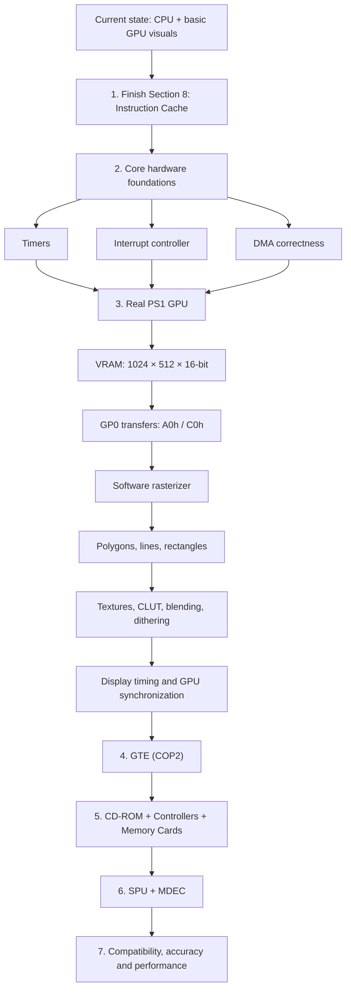

# PS1 Emulator Development Roadmap

This roadmap starts from the current project state: CPU implementation is underway and basic GPU visuals are appearing on screen.

The goal is to move through small, testable milestones rather than trying to implement the entire PlayStation at once. The guide's section numbers are a learning path, not the complete project roadmap.

## Roadmap at a glance

## 1. Finish the instruction cache

Complete Section 8 of the guide. The debugger can wait.

Suggested tests:
- Cache hits and misses.
- Tag changes.
- Fetching the remaining instructions in a cache line.
- Cache invalidation behaviour.

## 2. Complete core hardware foundations

Get these systems behaving reliably:
- Timers.
- Interrupt controller.
- DMA.

These are shared foundations for several devices, so test them independently.

## 3. Build a real PS1 GPU

This is the main graphics milestone.

### 3.1 Implement VRAM

Start with a `1024 × 512` array of `u16` pixels.

Add small read/write helpers and tests for address wrapping.

### 3.2 Implement VRAM transfers

Start with:
- GP0(02h): Fill VRAM.
- GP0(A0h): CPU-to-VRAM transfer.
- GP0(C0h): VRAM-to-CPU transfer.
- GPUREAD: Return the data requested by GPU read operations.

### 3.3 Implement rasterization

Move primitive drawing into the emulated GPU. Start with:
1. Flat-shaded, untextured triangles.
2. Gouraud-shaded triangles.
3. Rectangles.
4. Drawing-area clipping.
5. Textured polygons.
6. Texture pages and CLUTs.

### 3.4 Implement rendering behaviour

Then add:
- Texture windows.
- Semi-transparency.
- Dithering.
- Mask bits.
- Correct GP1 display settings.
- GPU timing, FIFO readiness, interrupts, and DMA synchronization.

### Keep the frontend separate

Keep the existing `winit + glow` setup if it is working.

The emulated PS1 GPU should render into its own VRAM. OpenGL should display the resulting VRAM image, rather than being responsible for rasterizing PS1 primitives directly. This keeps emulated hardware behaviour separate from host rendering.

## 4. Implement the GTE

Implement COP2 instructions and the Geometry Transformation Engine:
- Fixed-point calculations.
- Transformations.
- Lighting.
- Projection.

The GTE is particularly important for 3D games.

## 5. Implement CD-ROM and input devices

Add these as independent subsystems:
- CD-ROM.
- Controllers.
- Memory cards.
- SIO communication.

## 6. Implement SPU and MDEC

Later, add:
- SPU for audio.
- MDEC for video decompression.

These can wait until the CPU, GPU, and core hardware foundations are more complete.

## 7. Compatibility, accuracy, and performance

Test progressively:
- Small unit tests for individual hardware behaviours.
- BIOS booting.
- Homebrew programs.
- Commercial games when the emulator is ready.

Use failures to identify timing, synchronization, accuracy, and performance issues.

## Recommended references

| Resource | How to use it |
|---|---|
| [PSX-SPX](https://psx-spx.consoledev.net/) | Main PlayStation hardware reference. |
| [PSX-SPX GPU documentation](https://psx-spx.consoledev.net/graphicsprocessingunitgpu/) | GPU commands, VRAM, and display behaviour. |
| [PSX Wiki](https://psx.wiki/) | Alternative hardware documentation. |
| [DuckStation source code](https://github.com/stenzek/duckstation) | Study a mature emulator's architecture and individual subsystem implementations. |
| [Avocado emulator](https://github.com/JaCzekanski/Avocado) | Compare another emulator implementation. |

Do not try to copy a mature emulator's architecture wholesale. Use its source code to understand particular subsystems when the hardware documentation or your own implementation leaves questions.

## Recommended workflow for every subsystem

1. Read the relevant hardware documentation.
2. Understand the registers, commands, and expected behaviour.
3. Implement the smallest useful part.
4. Write tests for it.
5. Run it through the emulator.
6. Move to the next part.

## Immediate next steps

1. Finish Section 8: instruction cache.
2. Start implementing real GPU VRAM.
3. Implement and test GP0 fill and transfer commands.
4. Move primitive rasterization into VRAM.
5. Display the resulting VRAM image through OpenGL.

Do not rush into CD-ROM or GTE yet. Getting GPU commands to modify real PS1 VRAM is the next major milestone.
