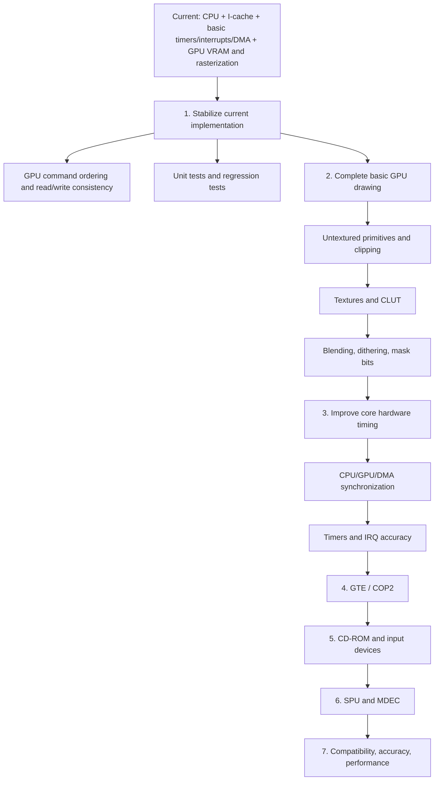

# PS1 Emulator Development Roadmap

This roadmap is based on the current project snapshot that was reviewed: the emulator already has a working display path and meaningful GPU/VRAM functionality. This is an incremental plan, not a requirement to follow every item in a tutorial in order.

The goal is to build a small, testable emulator core first, then improve hardware accuracy and add the remaining devices.

## Current project status

### Implemented or substantially underway

- CPU instruction execution and decoding, with exception and delay-slot handling underway.
- Instruction cache (I-cache) implemented and integrated. **Section 8 of the guide is no longer an outstanding milestone.**
- Basic interrupt controller.
- Basic timers.
- A DMA subset, including OTC and GPU transfer paths, with completion/interrupt handling.
- GPU-owned `1024 × 512` VRAM using 16-bit pixels.
- GP0 VRAM fill and CPU-to-VRAM image transfer, plus VRAM-to-CPU readback paths.
- Software rasterization for a limited set of triangle and rectangle commands.
- An OpenGL frontend (`winit + glow`) that displays the emulated VRAM.

### Still incomplete / needs validation

- GPU command ordering and synchronization need careful checking.
- GPU command coverage is limited; textured primitives and several rendering features are not implemented yet.
- Timers, interrupts, and DMA are functional foundations, not cycle-accurate implementations.
- Debugger remains a stub; it is useful but not a blocker for continuing emulation.
- GTE/COP2, CD-ROM, SPU, MDEC, controllers, and memory cards remain future subsystems.
- Add automated tests. The repository review did not identify a meaningful test suite, and the project has not been built or tested as part of this roadmap review.

## Roadmap at a glance

## 1. Stabilize what is already implemented

**This is the immediate priority.** Before adding more hardware, make the current GPU and core systems predictable and testable.

### 1.1 Preserve GPU command order

Commands sent to the PS1 GPU must affect VRAM in the same order they were issued.

- If drawing primitives are queued, flush earlier queued work before a later command directly reads or writes VRAM.
- Ensure GPUREAD/readback sees all earlier commands that should already have completed.
- Check interactions between queued triangles/rectangles and immediate operations such as VRAM fill or image transfers.
- Add regression tests for mixed command sequences, not only isolated commands.

### 1.2 Add focused tests

Start with small tests that are easy to debug:

- I-cache hit, miss, tag change, line-fill behaviour, and invalidation expectations.
- VRAM pixel addressing, clipping, and boundary handling.
- GP0 fill dimensions and alignment.
- CPU-to-VRAM transfer word/pixel counts and odd dimensions.
- VRAM-to-CPU readback and transfer progression.
- Triangle edge cases, rectangle bounds, and drawing-area clipping.
- DMA completion and interrupt signalling.
- Timer target/overflow and interrupt behaviour supported by the current implementation.

Run `cargo test` and `cargo check` regularly, and keep each new feature in a small commit.

## 2. Complete a useful basic GPU

The GPU should render into its own emulated VRAM. The host OpenGL frontend should display that VRAM; it should not implement PS1 primitive behaviour itself.

### 2.1 Finish untextured primitives

- Verify flat-shaded triangles.
- Add/verify Gouraud-shaded triangles.
- Complete rectangle variants (variable, 1×1, 8×8, 16×16, as applicable).
- Add line drawing and polygon variants as needed by the command set.
- Implement correct drawing-area clipping and drawing offsets.
- Define consistent pixel coverage rules for shared triangle edges to avoid gaps or unintended double-drawing.

### 2.2 Implement textured primitives

Proceed in small steps:

1. Texture page selection.
2. Texture formats and texel decoding.
3. CLUT lookup for indexed textures.
4. UV interpolation across polygons.
5. Texture-window behaviour.
6. Texture modulation and raw-texture mode.

Replace any placeholder texture rendering with actual VRAM sampling.

### 2.3 Add rendering effects and mask behaviour

- Semi-transparency modes.
- Dithering.
- Set-mask and check-mask behaviour.
- Correct handling of transparent texels and texture blending.
- Remaining GP1 display configuration needed to display the correct VRAM region and dimensions.

### 2.4 Improve the frontend only when needed

Keep `winit + glow` for now; there is no need to switch frameworks just because the emulator is still early.

Possible later optimization: reuse the RGBA conversion buffer and upload only the changed/visible region instead of allocating and converting the full VRAM every frame. Correct 5-bit-to-8-bit channel expansion can also be improved after correctness tests are in place.

## 3. Improve timing and hardware synchronization

Once GPU commands and tests are stable, improve timing across the existing devices:

- GPU command/FIFO readiness and busy status.
- GPU scanline, frame, and vblank timing.
- DMA transfer timing and synchronization with GPU operations.
- Timer clock sources, synchronization modes, and IRQ details.
- Interrupt priority/status/mask behaviour and acknowledgement.
- CPU cycle accounting and device advancement.

Avoid trying to make every subsystem cycle-accurate at once. Add one documented behaviour, test it, and then continue.

## 4. Implement the GTE (COP2)

Begin the Geometry Transformation Engine after the CPU and GPU command path are reasonably stable.

Suggested order:

1. COP2 register and instruction plumbing.
2. Fixed-point arithmetic and flag behaviour.
3. Matrix/vector operations.
4. Projection and depth-related operations.
5. Lighting and color operations.
6. Command timing and edge cases.

Use targeted tests for numeric results and overflow/flag behaviour. The GTE is essential for many 3D games, but it is not the best next task before the current GPU path is tested.

## 5. Add CD-ROM and input devices

Implement these as separate modules with clear interfaces:

- Controller protocol and buttons.
- Memory cards.
- SIO communication.
- CD-ROM command handling, sector reads, and interrupts.

Start with the smallest path that allows homebrew or a test program to communicate with a device. Add disc image support and timing incrementally.

## 6. Add SPU and MDEC

Later subsystems:

- SPU: register access, voices, sample playback, and audio output.
- MDEC: command/data handling and image decompression used by video playback.

These are substantial features; defer them until the CPU, GPU, and device communication foundations are more reliable.

## 7. Compatibility, accuracy, and performance

Test progressively:

1. Unit tests for individual hardware behaviours.
2. Small homebrew/test programs.
3. BIOS boot and basic system behaviour.
4. More demanding homebrew and demos.
5. Commercial games only when the emulator is ready for broader compatibility testing.

Use failures to identify whether the cause is CPU correctness, GPU behaviour, timing, DMA, or a missing device. Avoid adding large features just to work around a bug in an existing subsystem.

## Recommended workflow

For each feature:

1. Read the relevant hardware documentation.
2. Identify registers, commands, state transitions, and timing requirements.
3. Implement the smallest useful slice.
4. Write a test before adding the next slice.
5. Run `cargo check` and `cargo test`.
6. Verify the behaviour in the emulator.
7. Commit the working change.

Use mature emulator source code to answer specific implementation questions, not as an architecture to copy wholesale.

## References

| Resource | How to use it |
|---|---|
| [PSX-SPX](https://psx-spx.consoledev.net/) | Main hardware reference. |
| [PSX-SPX GPU documentation](https://psx-spx.consoledev.net/graphicsprocessingunitgpu/) | GPU commands, VRAM, and display behaviour. |
| [PSX Wiki](https://psx.wiki/) | Alternative hardware documentation. |
| [DuckStation source code](https://github.com/stenzek/duckstation) | Study specific subsystem implementations and edge cases. |
| [Avocado emulator](https://github.com/JaCzekanski/Avocado) | Compare another emulator's implementation choices. |

## Immediate next steps

1. Fix and test GPU command ordering, especially queued primitives followed by immediate VRAM operations or readback.
2. Add a small GPU test suite for fill, transfer, readback, triangles, rectangles, and clipping.
3. Add I-cache regression tests and verify cache-control/invalidation expectations.
4. Finish the remaining basic untextured GPU command variants.
5. Implement real texture sampling and CLUT support.
6. Add semi-transparency, dithering, and mask-bit behaviour.
7. Improve GPU/DMA/timer synchronization before moving on to the GTE.

**Do not restart the tutorial or switch frontend frameworks.** The project has already moved beyond the roadmap's original “start VRAM and display it” stage. The best next step is to stabilize and test the code that is already there, then extend the GPU in a controlled way.
